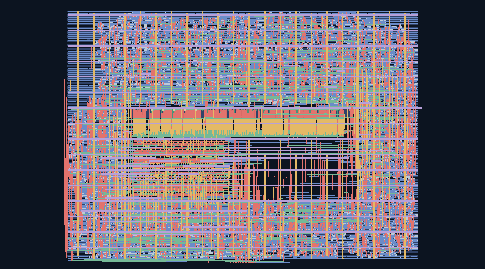

# Sky130 fractional-N PLL for Chipalooza Challenge #4

A proposal-stage SoC clock macro with a phase-domain all-digital loop and a transistor-level Sky130A ring oscillator. The design targets **160–300 MHz** from a **16–32 MHz** reference. It uses a 1.8 V core and requests a dedicated reference pad and divided monitor pad.

The PLL has a coarse/fine DCO, a 40-bin phase detector, selectable tracking bandwidth, and frequency-aware acquisition. Weak fine tuning triggers a longer rail measurement. The compact Sky130 wrapper offers nominal and slow-cold phase tables and an optional narrower tracking bandwidth on the channels immediately beside integer ratios. A build-time option enables on-chip code-density calibration. Configure the reference upper bound and the coarse-code ceiling for the intended operating point. The nominal channel is 25 MHz to 256.25 MHz.



The locally routed **460 × 330 µm** PLL passes enabled geometry DRC, full device LVS and extracted-wire TT timing. At slow-cold, the 300 MHz target falls inside two measured coarse settings with **2.99 MHz of overlap** after 900 ns of settling. Characterization uses the same extracted oscillator for frequency and phase. [Measurements, replay instructions and limits](results/range-dco/README.md) · [Routed layout record](results/range-dco/routed-layout.json)

| Measurement | Rev. 4 | Updated design |
| --- | --- | --- |
| TT, 1.80 V, 25 °C at fixed 52:64 | 98.78 MHz, 30 of 40 bins occupied | 296.97 MHz, 12 of 40 bins occupied |
| SS, 1.62 V, 0 °C at fixed 255:128 | 151.50 MHz at 1.40 mW | 355.61 MHz at 2.91 mW |
| Routed TT worst setup / hold slack | −29.06 / +0.12 ns | +0.28 / +0.18 ns locally |
| Routed outline | 600 × 400 µm (0.2400 mm²) | 460 × 330 µm (0.1518 mm²) |

The original planning allowance was 0.100 mm². The updated wrapper requires at least 0.1179 mm² at the 65% cell-packing limit before margins. The clock controller uses a 400 MHz guard and configurable coarse ceilings. The table gives fixed-code oscillator probes. Nominal lock at 256.25 MHz is measured separately in closed-loop replay. [Rev. 4 comparison build](https://github.com/jonahsaunders/VIBE_PLL/actions/runs/43496481088) · [Current workflow and measured limits](https://github.com/jonahsaunders/VIBE_PLL/actions/workflows/standalone-route.yml)

- [Design, controls, and timing](docs/design.md)
- [Chipalooza #4 proposal](docs/proposal.md)
- [Verification results](results/README.md)
- [Area and floorplan check](results/slot-fit.md)
- [Acquisition, spur, and DCO load verification](results/rev3.md)
- [Rev. 4 detector, supply, and capture verification](results/rev4.md)
- [Standalone floorplan and timing constraints](physical/README.md)
- [Original literature review and design report](chipalooza4-sky130-pll-report.pdf)

## Reproduce the checks

Use Python 3.10+, Icarus Verilog 12+, and ngspice with an installed open_pdks Sky130A device library. NumPy is needed for the sampled-loop and spectral analysis.

```sh
python tests/run_rtl.py --fixed-centers
python tests/run_rtl.py --fixed-centers --corner-grid
python tests/run_rtl.py
python analysis/loop_budget.py --tracking-gear 2
python spice/dco_deck.py --emit spice/cpz4_dco.spice
python spice/dco_deck.py --lib "$PDK_ROOT/sky130A/libs.tech/ngspice/sky130.lib.spice" \
  --aggregate-dac --corner tt --vdd 1.8 --temp 25 --codes 52 --fine-codes 64,65 --output nominal-step.csv
python tests/run_rtl.py --spice-data results/rev2-tt.csv --fixed-centers --start 40961 \
  --narrow-near-integer --spectrum-edges 524288 --spectrum edges.csv
python analysis/spectrum.py edges.csv --lower 1000
```

For a closed-loop replay, run the circuit sweep at several coarse codes and fine settings, including both fine rails, then use `python tests/run_rtl.py --spice-data sweep.csv --ref 25`. The replay limits the controller to the highest measured coarse code. See the verification results for the exact sweep and replay settings. The RTL regression covers lock, retuning, reference-loss holdover and the startup guard. Run it without `--fixed-centers` to exercise the on-chip calibration option.

The Rev. 4 prototype adds isolated, DCO-biased delay replicas. Generate it with `python spice/dco_deck.py --tracking-replicas --emit spice/cpz4_dco_tracking.spice` and pair it with the wrapper built using `TRACKING_REPLICAS=1`. The Rev. 4 results give commands for the ideal quarter-bin replay, the transistor-derived phase replay, and a separate filtered-bias experiment.

The original PLL used a 10-bin detector and a single DCO bank. Its results and report document the baseline at [`feb059e`](https://github.com/jonahsaunders/VIBE_PLL/tree/feb059ec1b7f6b69b3c953039adff4dc6c05cbea).

## Implementation status

The RTL and transistor schematic are available under Apache-2.0. Schematic simulations and pre-layout timing checks use external Sky130A models. Tapeout sign-off requires full extracted PVT, mismatch, phase noise, physical CDC, and harness layout.
