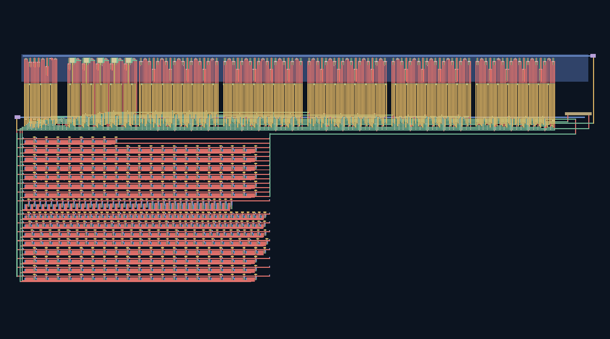

# Sky130 physical implementation

The layout flow supports both oscillator circuits and uses the Rev. 4 tracking
replicas by default. The 406-port interface, 255 coarse slices, 128 fine slices,
five ring taps, and fifteen isolated fine taps are retained.



| Oscillator | Devices | Size | Enabled geometry DRC | Device LVS |
| --- | ---: | ---: | --- | --- |
| Legacy | 870 | 130 × 105 µm | 0 markers | Match |
| Tracking replicas | 1,010 | 290 × 115 µm | 0 markers | Match |

These results apply to the oscillator macros. Full-PLL results must come from
the routed build's `physical-verification.json`; the macro results do not
establish a full-PLL pass. See [verification evidence](../results/rev4-layout.md).

## Reproduce the oscillator checks

Use KLayout 0.30.13 and its Python package, plus the Sky130A open_pdks
verification decks. Ubuntu CI installs the pinned upstream executable with
`physical/install_klayout.sh`; the build log records its package digest.

```sh
python3 physical/layout_dco.py --schematic spice/cpz4_dco_tracking.spice --output build/tracking
python3 physical/check_dco.py --pdk "$PDK_ROOT/sky130A" --build build/tracking
python3 tests/check_physical_guards.py --pdk "$PDK_ROOT/sky130A" --build build/tracking
klayout -b -r physical/render_layout.py \
  -rd input=build/tracking/cpz4_dco.gds -rd output=build/tracking/layout.png
```

Omit `--schematic` to generate the legacy circuit. Its GDS is byte-for-byte
identical to the checked physical-bringup baseline. The tracking layout places
every device in `cpz4_dco_tracking.spice`, including the bias-controlled delay
stages, sample buffers, fine-tap output buffers, and matched dummy loads.
The resistor and fine-bias escape use separate routing columns.

The checker records input and deck SHA-256 hashes. It deletes stale reports and
fails on any enabled geometry violation or device/net mismatch. The negative
regression changes a transistor connection and inserts undersized metal to
verify that both failures are rejected.

The enabled KLayout groups are FEOL, BEOL, and manufacturing-grid checks.
They do not include harness, seal-ring, density, or all foundry sign-off checks.

## Standalone PLL

```sh
export ORFS_SKY130HD=/path/to/OpenROAD-flow-scripts/flow/platforms/sky130hd
export SKY130A="$PDK_ROOT/sky130A"
bash physical/run_standalone.sh build/standalone
```

The range-DCO integration floorplan is **460 × 330 µm**, with a 5 µm edge margin and a
298 × 123 µm tracking-DCO reservation, including its 4 µm halo. This is larger
than the historical 400 × 250 µm planning target and is not a claim that the
Rev. 4 layout fits that original slot. Approved harness dimensions still
control the final integration.

The flow synthesizes the matching controller, builds power and clock routing,
runs full detailed-route optimization, streams the real standard-cell and DCO
GDS, and exports intended connectivity from the routed database. The LVS
reference includes real standard-cell transistor definitions and the DCO
reference; missing cells or unsupported devices cause a failure. Full-chip LVS
extracts the device geometry and compares flattened connectivity graphs.
The wrapper recognizes N+ antenna diodes using substrate geometry outside
physical wells and emits their anodes onto the deck's shared substrate
terminal layer. Junction area, perimeter, and both terminals remain checked,
without requiring a closed local tap ring. A negative regression removes diode diffusion and
requires full-chip LVS to reject the damaged layout.

Only a successful route, connected power grids, zero antenna violations,
zero enabled geometry DRC markers, and matching full-device LVS can produce
`cpz4_sky130.gds`. Other routed geometry is `cpz4_sky130-review.gds`.
The [workflow](../.github/workflows/standalone-route.yml) publishes diagnostics
and does not truncate routing to one iteration.

| Setting | Default | Purpose |
| --- | --- | --- |
| `TRACKING_REPLICAS` | `1` | Select the matching circuit and phase-center tables; `0` retains legacy support |
| `RANGE_DCO` | Same as `TRACKING_REPLICAS` | Select the higher-drive ring, local tap buffers and extracted TT/SS tables. Set to zero to reproduce the earlier tracking circuit. |
| `ON_CHIP_CAL` | `0` | Set to `1` to retain histogram calibration in the mapped controller |
| `MAX_COARSE_CODE` | `255` | Hard coarse-code ceiling; lower to the validated operating limit |
| `PLACE_DENSITY` | `0.62` | Placement density |
| `DIE_AREA`, `CORE_AREA` | Above | Override together for the allocated outline |
| `DCO_RESERVE`, `DCO_HALO_UM` | Above | Must contain the actual macro and its halo |

Re-run the area and physical checks for each build-time configuration.
The route emits `area.json`, `physical-verification.json`, and a separate
`timing-verification.json` from the CI timing check. The physically checked
Rev. 4 baseline used 600 × 400 µm. Its measured cell area and DCO reservation
require at least 0.117 mm² at the project's 65% packing cap, before margins.
Use the allocated harness outline for the integration build. See the
[range-DCO measurements and replay commands](../results/range-dco/README.md).
The filtered-bias circuit remains an explicit schematic experiment; the
tracking layout described here uses the unfiltered tracking schematic.

## Timing, extraction, and integration

The Rev. 4 [timing constraints](standalone.sdc) and
[capture-path reports](capture_paths.tcl) are retained. Capture reports run
after routed parasitics are loaded. Set `DCO_PERIOD_NS` from the shortest
characterized acquisition period, including code transitions, and sweep
`DCO_HIGH_NS` at the duty-cycle limits. Review the Gray and phase-tap capture
apertures, counter-edge selection, clock skew, recovery, and removal.

Magic's `extract_dco.tcl` runs its full DRC style and refuses extraction on a
nonzero violation count. The SPICE runner accepts the extracted netlist while
retaining tracking, filtered-bias, supply-ripple, startup, and skewed-transition
experiments. The asynchronous DAC reset behavior is preserved.

DRC/LVS alone does not qualify oscillator range, jitter, supply pushing, timing,
or the harness. Use extracted PVT characterization and closed-loop replay
before assigning production limits. The schematic-based regressions remain
available for all original modes.

The prior physical-bringup measurements and routing limitations are retained
in [the historical report](legacy-bringup.md).
