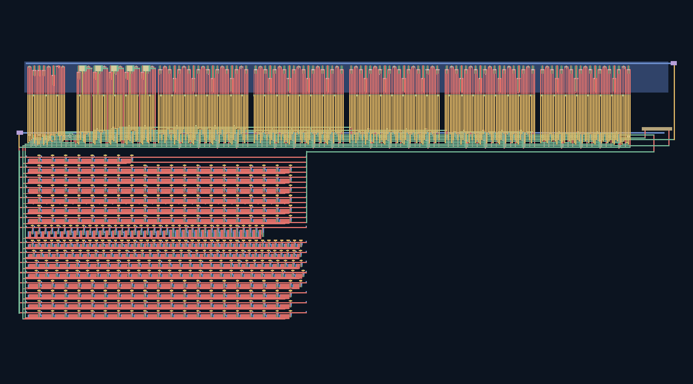

# Rev. 4 physical verification

The tracking-replica oscillator has been laid out without removing the isolated
launch/sample buffers, current-starved replicas, fine-tap buffers, or dummy
loads. It retains the same 406-port boundary and every one of the schematic's
1,010 primitive devices.

## Oscillator results

| Circuit | Footprint | Enabled KLayout DRC | Transistor-level LVS |
| --- | --- | --- | --- |
| Legacy | 130 × 105 µm | 0 markers | Match |
| Rev. 4 tracking | 290 × 115 µm | 0 markers | Match |

[Tracking check record](rev4-dco-verification.json) ·
[Legacy check record](legacy-dco-verification.json)

The local checks used KLayout 0.30.5. The DRC source is
`efabless/mpw_precheck@07ace967fbe88e33844bf046bd9d30e1679580b7`,
`checks/tech-files/sky130A_mr.drc`; enabled groups are FEOL, BEOL, and off-grid.
The LVS source is
`mabrains/sky130_klayout_pdk@00f6055166cf790587c457f90bbcba33fc076dcd`,
`sky130_tech/tech/sky130/lvs/sky130.lvs`. The portability wrapper normalizes
identifier case and preserves explicit resistor/capacitor parameters. It does
not remove devices, waive net mismatches, or disable geometry checks.

The legacy GDS SHA-256 remains
`ead7d89d68cd50b798ee1402250d4c88fe9066a37403a813827fa2feb35d2352`,
identical to the physical-bringup baseline.

Negative checks confirm that a deliberately disconnected transistor gate fails
LVS and a 50 nm metal square fails DRC. Both checks replace stale success
records with a failed result.

## Feature regression

The integrated RTL passed the Linux
[feature regression](https://github.com/jonahsaunders/VIBE_PLL/actions/runs/43467733920/job/132031243268):
four fixed-center behavioral scenarios, twelve PVT/reference corner replays,
four on-chip-calibration scenarios, and the tracking-replica replay.
Gray-counter wrap, phase-sampler ambiguity, bounded startup retry, and hard
coarse-code ceiling unit tests also passed.

The original RTL, schematic experiments, calibration option, slow-cold and
nominal phase tables, selectable tracking bandwidth, near-integer mode,
reference-loss holdover, retuning, coarse/fine DACs, and startup/overspeed
protections remain available. The DAC output registers retain asynchronous
reset behavior. The physical branch's equivalent coarse-step arithmetic
optimization and extracted-netlist bench support are retained.

## Full-PLL status

The complete standalone build is a separate verification target. Its initial
integration floorplan is 600 × 400 µm, larger than the original planning slot.
A passing oscillator result must not be substituted for full-chip DRC/LVS.

The flow now runs device-level LVS on the complete streamed layout, requires
zero enabled geometry and route DRC, checks signal/power connectivity and
antenna results, and keeps failing geometry under a `-review.gds` name.
The authoritative result for each routed build is its
`physical-verification.json`, with hashes of the actual GDS and reference.

The [standalone Rev. 4 route](https://github.com/jonahsaunders/VIBE_PLL/actions/runs/43496481088/job/132130802878)
subsequently passed enabled geometry DRC (zero markers), device-level LVS,
route DRC, antenna and supply connectivity at commit `8a66f63`. Worst max
slack was −29.06 ns on a reset recovery path. A 32 MHz reference-clock path
from the phase sampler to the fine DAC code missed by 22.77 ns.
The [extracted maximum-code probes](https://github.com/jonahsaunders/VIBE_PLL/actions/runs/43496481088/job/132130803171)
reached 294.6974 MHz at TT and 151.4959 MHz at slow-cold. Timing and
operating-range qualification remain open for that revision.
See [commands and configuration](../physical/README.md).
